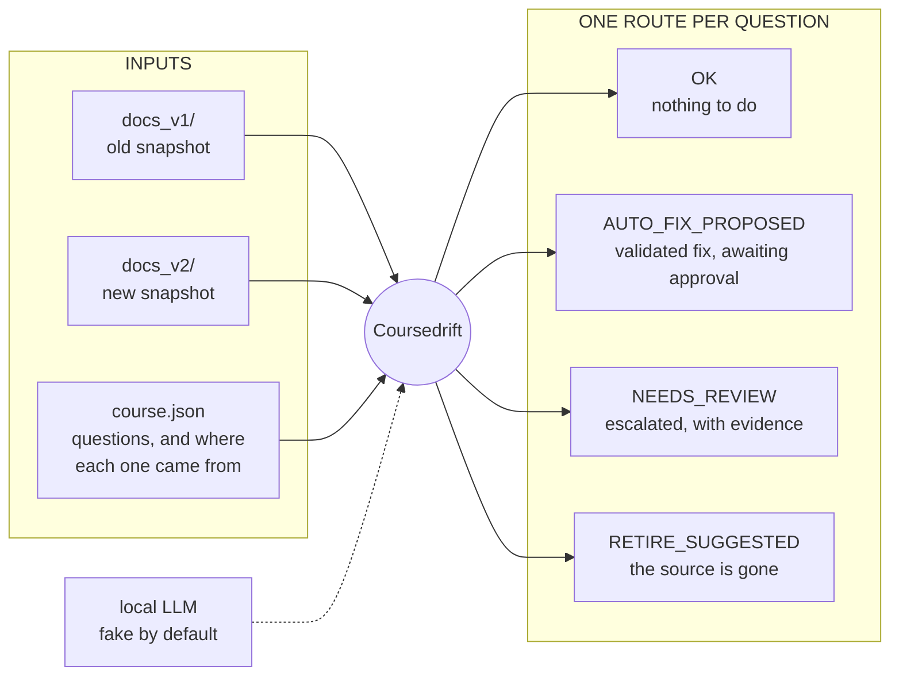
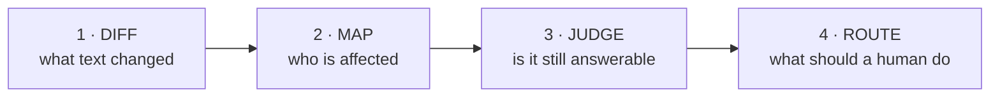

# Coursedrift

**CLI tool that re-checks a generated course against its updated source documents, flagging the questions an update broke, proposing verified fixes where it's certain, and escalating the rest with evidence.**

**Use Case:**
An admin uploads documents and they become a course. Later the documents are
re-uploaded with revised policies, deleted, or reorganised — and the course
quietly keeps teaching the old version. Coursedrift finds the questions that
broke, proposes grounded fixes for the ones it is sure about, and escalates
everything else to a human with the evidence attached.

> [!note]
> It never edits the course. Every output is a proposal.

**Who it helps.** The L&D admin, whose only alternatives today are regenerating
the course — losing every edit and all progress data — or re-reading it by
hand. And the employee: in a gamified app, the person who knows the *current*
policy answers correctly, is marked wrong, and loses XP for being right.

**Why this problem.** The brief's example ideas are all *generation*, and
Masterbrain already generates. Maintenance is what happens next, and it is
where an LLM is the right tool but a dangerous one to trust alone.

---

## What it does



Reports are written as `drift_report.md` for the reviewer and
`drift_report.json` for a future review queue.

```bash
uv sync      # once
make demo    # full run on a seeded corpus — no network, no model, no API key

# Live Demo Run
cd scratch/user-testing
tree .   # Easier to see structure

uv run drift seed --docs docs_v1 --out test_course.json

ollama serve

uv run drift run --old docs_v1/ --new docs_v2/ --course test_course.json --out test-report --client ollama --model qwen3.5:9b --timeout 60
```

---

## How it works



| step | deterministic? | what it decides |
| --- | --- | --- |
| 1 · Diff | yes | Which spans were modified, moved, removed or added |
| 2 · Map | yes | Which questions those spans belong to, and which need judgment |
| 3 · Judge | **LLM** | Whether a change breaks a question, and how to fix it |
| 4 · Route | yes | One of four routes, with the reason it was chosen |

Steps 1, 2 and 4 involve no model at all. On the fixture corpus, 14 questions
narrow to **6** that reach an LLM, in 8 calls — the rest are decided, or
dismissed, for free.

---

## The parts in detail

### Step 1 — Diff the documents

| file | role |
| --- | --- |
| [`corpus.py`](coursedrift/corpus.py) | Loads a directory of Markdown into a snapshot; classifies each document as unchanged / modified / added / deleted |
| [`segment.py`](coursedrift/segment.py) | Splits documents into sentence-level **spans**, each with a content hash and a section path |
| [`diff.py`](coursedrift/diff.py) | Matches old spans to new ones |
| [`lis.py`](coursedrift/lis.py) | Longest increasing subsequence, used to tell a *move* from a *reorder* |

Matching runs in three phases, and the order is the single most important
design decision in the project:

- **Phase A — identity by content hash**, corpus-wide. Position is never
  consulted, so a reordered document produces matches rather than deletions,
  and content moved between files is still found.
- **Phase B — similarity** for whatever Phase A could not match. A shingle
  index blocks candidate pairs so this stays near-linear. Two scores come out:
  an order-*insensitive* one that decides pairing, and an order-*sensitive* one
  that gets reported.
- **Phase C — position**, finally, and only to classify movement. The LIS of
  matched positions is the stable core; everything outside it moved.

Each span change carries two axes — what happened to its text
(`IDENTICAL` / `COSMETIC` / `MODIFIED` / `REMOVED` / `ADDED`) and what happened
to its place (`STABLE` / `MOVED` / `REPARENTED`).

### Step 2 — Map questions to changes

| file | role |
| --- | --- |
| [`anchor.py`](coursedrift/anchor.py) | Relocates each question's recorded source span in the new corpus: exact hash, then fuzzy text, then an honest `ORPHANED`. Includes a bounded BM25 fallback for questions with no recorded provenance |
| [`impact.py`](coursedrift/impact.py) | Joins questions against the change table and decides which actually need judgment |

`requires_adjudication` is the whole cost-control story in one function: an
identical span that merely moved is not drift, a cosmetic edit is not drift, a
removed span needs no model to interpret. Only `MODIFIED` spans — and spans
that moved to a different section while keeping their text — go further.

### Step 3 — Judge the affected

| file | role |
| --- | --- |
| [`llm/base.py`](coursedrift/llm/base.py) | **The one place model output becomes trusted data.** Tolerant extraction, strict validation, one repair attempt, then fail closed |
| [`llm/prompts.py`](coursedrift/llm/prompts.py) | Prompt templates; source text always travels inside labelled blocks |
| [`llm/fake.py`](coursedrift/llm/fake.py) | Deterministic stand-in, plus seven failure-injection modes |
| [`llm/ollama.py`](coursedrift/llm/ollama.py) | Real local model, with preflight checks |
| [`llm/cache.py`](coursedrift/llm/cache.py) | Memoizes responses by `sha256(client + prompt)` |
| [`adjudicate.py`](coursedrift/adjudicate.py) | Asks for a verdict: `UNAFFECTED` / `WEAKENED` / `INVALIDATED` / `UNCERTAIN` |
| [`remediate.py`](coursedrift/remediate.py) | Asks for a fix, and refuses bad ones |

How the model is kept honest:

- **`call_validated` never raises.** Callers receive an outcome they must
  route, which makes failing closed a property of the type signature.
- Responses parse into Pydantic models with closed enums and `extra="forbid"`.
- **Grounding is checked in code** — evidence quotes and a fix's `grounded_in`
  must appear verbatim in the text supplied, and a fix is grounded against the
  *new* document only.
- One repair attempt naming the error, then stop. Timeouts are not retried.
- Per-call timeout, whole-run call budget, and a cap on generated tokens.
- A cache hit is replayed through the same validation path, so a stored
  response that no longer validates is dropped rather than returned.
- **Prompt injection** is handled structurally, not by detection: a verdict
  must be one of four enum values and a fix must quote the real document, so
  even a successful injection cannot produce output that survives validation.

### Step 4 — Route and report

| file | role |
| --- | --- |
| [`triage.py`](coursedrift/triage.py) | Pure routing function — no I/O, no client, no clock |
| [`report.py`](coursedrift/report.py) | Renders Markdown for a human and JSON for a machine |
| [`pipeline.py`](coursedrift/pipeline.py) | Wires the stages together |
| [`cli.py`](coursedrift/cli.py) | `drift run`, `drift demo`, `drift seed` |

Eleven rules in precedence order. Everything the system could not decide lands
in `NEEDS_REVIEW`: a failed call, low confidence, disagreeing votes, an
ambiguous anchor, inferred provenance, a reparented span, a span rearranged
into the same words, or a fix that failed validation. Every finding records
which rule fired.

Shared types live in [`models.py`](coursedrift/models.py); every threshold that
can affect a verdict lives in [`config.py`](coursedrift/config.py) and nowhere
else.

[OVERVIEW.md](OVERVIEW.md) holds the design rationale, [PLAN.md](PLAN.md) the
phase-by-phase build plan the commits follow.

---

## Running it

| command | what it does |
| --- | --- |
| `make demo` | Full run on the fixture corpus, deterministic fake client |
| `make test` | 392 tests, offline |
| `make eval` | The evaluation set, case by case |
| `make check` | ruff + mypy |
| `make test-live` | Opt-in: runs against a real local model via Ollama |

On your own documents:

```bash
# 1. write a course from one snapshot, recording where each question came from
uv run drift seed --docs path/to/docs_v1 --out course.json

# 2. change the documents, then compare the two snapshots
uv run drift run --old path/to/docs_v1 --new path/to/docs_v2 \
                 --course course.json --out ./report
```

With a real model: `ollama pull qwen2.5:3b`, then add
`--client ollama --model qwen2.5:3b`.

Progress is printed to stderr as the run proceeds — each stage, and every
model call before it is made, so a slow model does not look like a hang. The
report itself goes to stdout, so piping it to a file stays clean.

Useful flags: `--client none` stops after the deterministic steps;
`--votes 3` escalates on any disagreement between runs;
`--fake-failures timeout,malformed,schema,ungrounded` exercises the recovery
paths; `--quiet` silences progress; `--fail-on-drift` exits non-zero for CI.

---

## Evaluation

`make eval` runs eleven designed cases and prints each by name with its
expected outcome.

| # | What changed | Expected |
| --- | --- | --- |
| 1 | Notice period 30 → 45 days | `AUTO_FIX_PROPOSED` |
| 2 | Paragraph reworded, meaning identical | `OK` |
| 3 | "Per-diem" section deleted | `RETIRE_SUGGESTED` |
| 4 | Document deleted, its content folded into another | `OK` |
| 5 | "are forfeited" → "may be forfeited, depending on local policy" | `NEEDS_REVIEW` |
| 6 | Whole document reordered, zero text edits | `OK` |
| 7 | Sentence moved into a "Deprecated Practices" section | `NEEDS_REVIEW` |
| 8 | A comma added | `OK` |
| 9 | A document carrying a prompt-injection payload | valid output |
| 10 | A question with no recorded provenance | `NEEDS_REVIEW` |
| 11 | "Always use X, never Y" → "Never use X, always Y" | `NEEDS_REVIEW` |

**How I judge usefulness**, in priority order:

1. **No false `OK`** — a broken question marked fine stays live and keeps
   punishing people. Everything uncertain escalates instead.
2. **No false alarms** — 8 of the 14 fixture questions must produce *no finding
   at all*. A tool that flags every reorder gets ignored by the third run.
3. **Every fix is grounded** — the quote is verified against the new document.
4. **The report explains itself** — every finding names the rule that routed it.

**The fake client can show** everything deterministic (three of the four steps)
plus the entire reliability layer — its injection modes produce real malformed
JSON, schema violations, ungrounded quotes and timeouts. Case 11 is the best
demonstration: the fake answers `UNAFFECTED`, the *wrong* answer, and a
deterministic rule overrides it anyway.

**It cannot show judgment quality.** Its verdicts are scripted, so it says
nothing about whether a real model understands a hedged rewrite, whether the
prompts are good, or whether the 0.75 confidence floor is calibrated. Its "fix"
for case 1 is a string substitution.

Partly closing that gap, against real local models (`make test-live`):

| model | observed |
| --- | --- |
| `qwen2.5:3b` | Full 14-question run, no timeouts, every route valid |
| `qwen3.5:9b` | Reaches `INVALIDATED` at confidence 1.00 on case 11 unaided |

Both are smoke tests, not correctness measurements. What is still missing is
evaluation against **human-labelled** drift — the fixture set tests the cases I
thought of, which is exactly its limitation.

---

## Design decisions and tradeoffs

- **Identity is content, never position.** More code than `difflib`, but a
  positional diff reports every span of a reordered handbook as deleted and
  proposes retiring content that is perfectly correct.
- **Two similarity scores.** Pairing is order-insensitive so rewords match;
  the *reported* score is order-sensitive, because "always X, never Y" and
  "never X, always Y" share every word and scored 1.00 under the first.
- **Deterministic rules can overrule the model.** A rearranged or reparented
  span routes to review regardless of verdict — these are exactly the cases
  where asking "did this change?" invites the answer "no". Cost: a benign
  reorder also goes to review. I took the false positive over the false negative.
- **Narrow before spending a call.** More code than sending everything to an
  LLM; buys cost, reproducibility, and a system testable without a model.
- **Proposal-only, always.** A human must act on every finding. For a system
  whose inputs include model judgments, that is the only defensible posture.
- **Inference is capped.** The BM25 provenance fallback can never auto-approve;
  its ceiling is `NEEDS_REVIEW`. The fuzziest component cannot approve anything.

---

## Limitations

- **Markdown only** — no PDF, DOCX or YouTube. The loader interface is pluggable.
- **The evaluation set is author-designed.** Recall on real-world drift is unmeasured.
- **The 0.75 confidence floor is a guess.** Nothing calibrates it.
- **Benign reorders produce false positives**, as above — accepted, not fixed.
- **Sentence splitting is regex-based.** Bounded rather than solved: a mis-split
  is stable across both snapshots, so it hashes identically on each side.
- **No persistence or incremental runs**; each run compares two directories afresh.
- **No performance guard** on the Phase B blocking — deferred deliberately,
  reasoning in [PLAN.md](PLAN.md).

**With more time**, in order: a human-labelled evaluation set, so recall and the
confidence floor stop being guesses; a triage UI (the JSON is already shaped for
a review queue); PDF and DOCX ingestion; feeding human approvals back as
labelled examples; per-item model routing.

Nothing is half-built — every stage in [PLAN.md](PLAN.md) is implemented and
tested.

---

## Tests

`make test` — 392 tests, offline, no LLM required.

| kind | covers |
| --- | --- |
| Unit | LIS, the normalization contract, every patch validator, triage as a truth table |
| Property-based | The core invariant over generated documents and arbitrary permutations; span conservation; LIS against a reference implementation |
| Integration | Real files on disk, across corpus → segment → diff → anchor → impact |
| Fault injection | Every recovery path, via the fake client's seven failure modes |
| Contract | Ollama's HTTP shape and failure mapping, through a mock transport |
| End-to-end | Full pipeline against byte-exact golden reports in Markdown *and* JSON; the CLI; the seed → run loop |
| Live, opt-in | A real model, including a regression for a timeout the offline suite could not catch |

The JSON golden exists because `drift_report.json` is an interface: without it,
a change to the report's shape passes the suite while silently breaking any
consumer. That is how the gap was found.

[OVERVIEW.md](OVERVIEW.md) holds the design rationale, [PLAN.md](PLAN.md) the
phase-by-phase build plan the commits follow.

---

## How I used AI tools

I used Claude Code (Opus 5) for design discussion and for writing essentially
all of the code and tests. I set the scope, reviewed the output, tested it
myself, and prompted further for adjustments — the useful work was in challenging what it produced.

**The suggestion I rejected that mattered most.** Before any code existed, the
plan used Python's `difflib.SequenceMatcher` to diff the documents. That is
order-dependent, so I asked what happens when a document's sections are simply
reordered. The answer: every moved span reported as deleted, every question
anchored to them orphaned, and the tool confidently proposing to retire content
that had not changed.

That reshaped the system. Matching became three phases with content-hash
identity first, and *"no stage may use positional order to establish identity"*
became a written invariant with its own regression test. Several later fixes
were just applying that rule where it had not yet reached.

Also caught in review: a meaning-reversing edit reported `similarity: 1.00`
because the scorer compared token *sets*; three fields on the span model were
written and never read; and a run against a larger local model timed out on
every call because of a hidden reasoning trace being generated and discarded.
The first and third were found by running the tool on my own documents, not by
any test.

---

## Time spent

Roughly **5–6 hours**, slightly over the brief's "around three to four hours".

The workload can be split in half. The first half was the implementation and the second half was the fixing of caught bugs and issues that surfaced as a result of testing.
